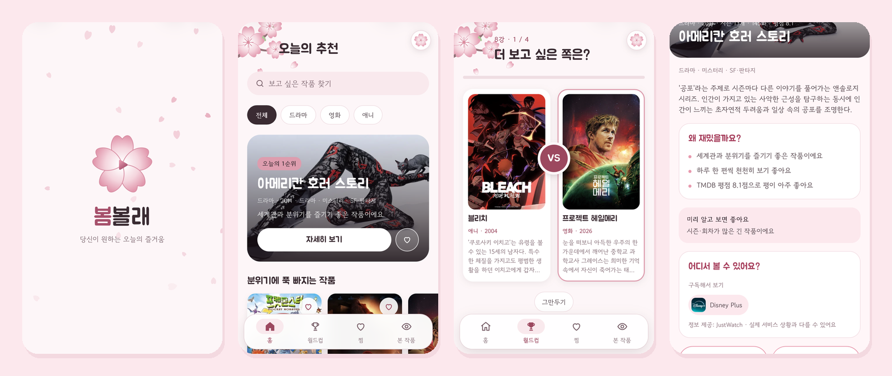

# 🌸 봄볼래 — 안 본 작품만 골라 주는 추천 앱

> "이거 볼래?" 본 작품은 빼고, 내 취향에 맞는 드라마·영화·애니만 **이유와 함께** 추천해 주는 웹 앱

**👉 바로 써 보기: [bombollae.vercel.app](https://bombollae.vercel.app)**




<sub>왼쪽부터 시작 화면 · 홈(오늘의 1순위와 추천 이유별 가로 줄) · 오늘의 한 편 월드컵 · 작품 상세(추천 이유와 볼 수 있는 곳)</sub>

---

## 1. 왜 만들었나요?

OTT를 오래 쓰다 보면 **본 작품이 너무 많아서**, 볼 것을 찾는 시간이 보는 시간보다 길어집니다.
그리고 막상 안 본 작품은 포스터와 줄거리만으로는 **재미없어 보여서** 손이 안 갑니다.

| 문제 | 봄볼래의 해결 방법 |
| --- | --- |
| 이미 본 작품이 추천에 계속 섞여 나온다 | 본 작품을 한 번 체크하면 추천에서 영구히 제외 |
| 안 본 작품은 재미없어 보인다 | "왜 나한테 재밌을지" 이유를 문장으로 보여 줌 |
| 넷플릭스·티빙·웨이브 등 서비스가 흩어져 있다 | 서비스 구분 없이 추천하고, 볼 수 있는 곳을 함께 표시 |

## 2. 주요 기능

- **1분 취향 설문**: 추천받을 종류 → 중요하게 보는 요소 → 피하고 싶은 요소 → 시청 습관
- **본 작품 체크**: 포스터를 누르면 "봤어요", 별(★)을 누르면 "인생작". 목록에 없으면 제목으로 검색
- **이유 있는 추천**: 취향·인생작·시청 습관·평점으로 점수를 매기고, 1순위 작품은 크게, 나머지는 "인생작과 비슷한", "반전이 끝까지 이어지는 작품"처럼 **추천 이유별 가로 줄**로 보여 줌
- **찾기**: 홈 화면 맨 위 검색창을 누르면 찾기 화면으로. 제목 검색(TMDB 전체), 종류·장르 버튼, "안 본 것만", 추천순·최신순·평점순·인기순 정렬. 검색어 없이 장르만 골라도 작품이 나옴
- **오늘의 한 편 월드컵**: 찜한 작품과 취향 추천작 8편이 VS로 맞붙어서 오늘 볼 작품을 최종 선택 (잘못 누르면 되돌리기)
- **미리 알림**: 피하고 싶다고 고른 요소(잔인함, 긴 시리즈 등)가 있으면 경고 표시
- **예고편 자동 재생**: 작품을 누르면 넷플릭스처럼 위쪽에서 소리와 함께 30초 미리보기, 오른쪽 아래 음소거 버튼 (한국어 예고편 우선, 없으면 영어, 둘 다 없으면 숨김)
- **어디서 볼 수 있는지**: 한국 기준 구독·대여·구매 가능한 서비스 표시 (JustWatch 데이터). 홈 추천은 처음부터 한국에서 정식으로 볼 수 있는 작품만 불러와서 '볼 곳이 없는 추천'이 나오지 않음
- **꽃 테마**: 오른쪽 위 꽃 버튼을 누르면 벚꽃·라벤더·수국·해바라기·튤립 중 바로 선택. 색과 장식 그림이 함께 바뀜
- **시작 화면**: 벚꽃이 피어나며 로고가 뜨는 2초짜리 애니메이션 (누르면 바로 넘어감)
- **PC에서도 보기 좋게**: 넓은 화면에선 왼쪽에 앱 소개와 휴대폰으로 여는 QR 코드, 가로 줄엔 마우스용 ◀ ▶ 버튼
- **휴대폰에 앱으로 설치(PWA)**: 홈 화면에 추가하면 벚꽃 아이콘이 생기고 주소창 없이 전체 화면으로 열림. 인터넷이 끊겨도 마지막 화면은 열림
- **링크 미리보기**: 카카오톡·노션 등에 주소를 붙이면 로고와 소개가 담긴 카드가 뜸
- **기록 저장**: 체크·찜·테마가 브라우저에 저장되어 다시 열어도 유지

## 3. 추천 점수는 이렇게 계산해요

TMDB가 알려 주는 **장르**를 앱의 **취향 꼬리표**로 바꾼 뒤 점수를 매깁니다. (`js/recommend.js`)

| 조건 | 점수 | 보여 주는 이유 예시 |
| --- | --- | --- |
| 설문에서 고른 요소와 겹침 (하나당) | +3 | "반전과 떡밥이 있는 장르라 다음 내용이 궁금해져요" |
| 인생작과 겹치는 장르 (하나당) | +1.5 | "인생작 「○○」와 장르가 비슷해요" |
| 시청 습관과 맞음 | +1 ~ +1.5 | "다음 화가 궁금해지는 장르라 몰아보기 좋아요" |
| TMDB 평점 8점 이상 | +1 | "TMDB 평점 8.6점으로 평이 아주 좋아요" |
| 피하고 싶은 요소가 있음 | −4 | (경고로 표시) |

장르 → 꼬리표 예시: 미스터리·스릴러 → 반전, 로맨스 → 케미, 코미디 → 웃음, 액션 → 빠른 전개

## 4. 구조

```
├── index.html          화면 뼈대
├── css/style.css       디자인 (색은 모두 CSS 변수 → 테마 전환)
├── js/
│   ├── app.js          상태 관리, 버튼 동작, 화면 다시 그리기
│   ├── views.js        상태를 받아 화면 HTML을 만드는 함수들
│   ├── recommend.js    추천 점수 계산, 이유별 가로 줄 구성
│   ├── tmdb.js         TMDB 데이터 요청·정리
│   ├── flowers.js      꽃 테마 SVG 그림
│   ├── config.js       문구, 장르 연결표, 테마 색
│   └── storage.js      브라우저 저장소
└── api/tmdb.js         Vercel 서버 함수 (TMDB 키를 숨기는 프록시)
```

```
[브라우저] ──/api/tmdb──▶ [Vercel 서버 함수] ──키를 붙여서──▶ [TMDB API]
            (키 없음)          (환경 변수에 키 보관)
```

**사용 기술:** HTML, CSS, JavaScript(ES Modules, 프레임워크 없이), PWA(Web App Manifest, Service Worker), Vercel Serverless Functions, TMDB API

## 5. 고민하고 해결한 점

**① API 키를 어떻게 숨길까?**
처음에는 브라우저에서 TMDB를 직접 불렀는데, 이러면 개발자 도구로 누구나 키를 볼 수 있었습니다.
그래서 Vercel 서버 함수를 중간에 두고, 키는 서버 환경 변수에만 보관했습니다.
이 함수가 아무 요청이나 대신 보내는 통로가 되지 않도록 **허용한 TMDB 주소만 통과**시키고, GET 요청만 받도록 막았습니다.
같은 요청은 Vercel 캐시에 1시간 저장해 TMDB 호출 횟수도 줄였습니다.

**② "재미없어 보인다"는 문제를 어떻게 풀까?**
추천 결과만 보여 주면 여전히 손이 가지 않았습니다. 점수를 계산할 때 **점수를 준 이유를 문장으로 같이 저장**해서,
추천 카드와 상세 화면에 "왜 재밌을지"를 바로 보여 주도록 설계했습니다.

**③ 데이터가 없는 경우**
포스터가 없거나 이미지가 깨지면 작품마다 정해진 파스텔 색과 제목으로 대신 보여 줍니다.
TMDB 요청 일부가 실패해도 성공한 결과만 모아서 보여 주고, 전부 실패하면 원인을 알려 주는 안내와 "다시 불러오기" 버튼을 띄웁니다.

## 6. 앞으로 하고 싶은 것

- 넷플릭스 시청 기록 파일(CSV)을 올리면 본 작품 자동 체크
- 리뷰를 요약해서 "3화부터 재밌어져요" 같은 더 구체적인 추천 이유 만들기
- 로그인해서 여러 기기에서 기록 동기화

## 7. 직접 실행해 보기

1. TMDB에서 API 읽기 액세스 토큰 발급 ([TMDB API 설정](https://www.themoviedb.org/settings/api))
2. Vercel에 이 저장소를 연결하고, 환경 변수 `TMDB_TOKEN`에 토큰 입력 후 배포
3. 내 컴퓨터에서 돌리려면: `.env.example`을 `.env`로 복사해 토큰을 넣고 `npx vercel dev`

---

작품 정보·포스터: [TMDB](https://www.themoviedb.org) · This product uses the TMDB API but is not endorsed or certified by TMDB.
시청 서비스 정보: [JustWatch](https://www.justwatch.com)
